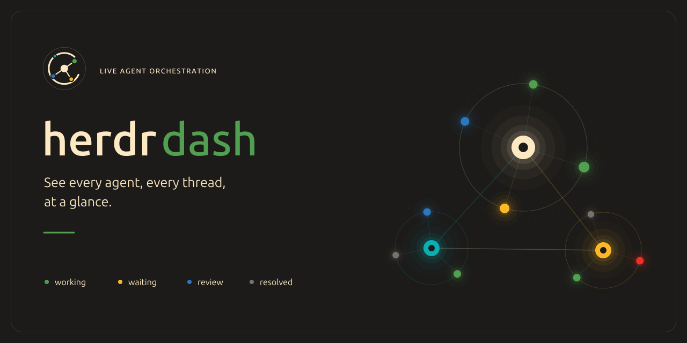
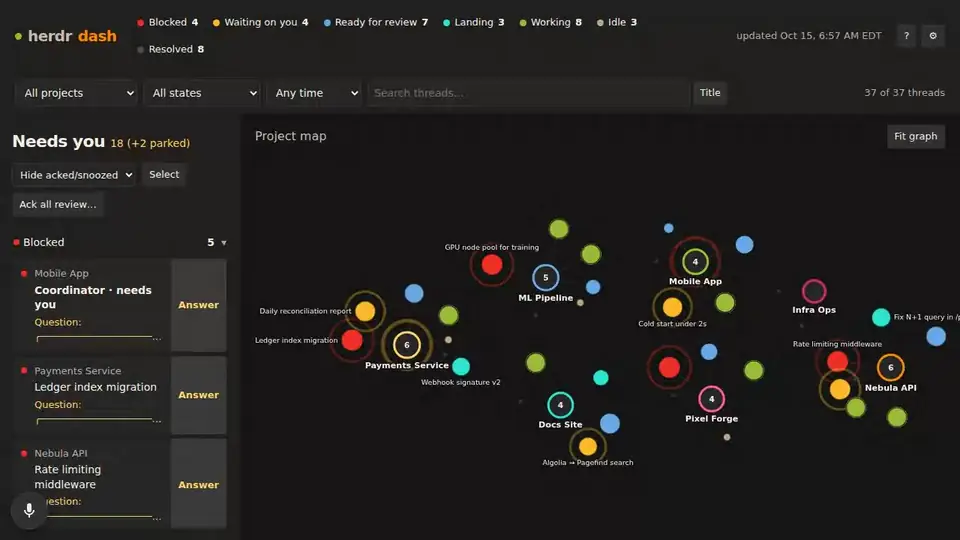
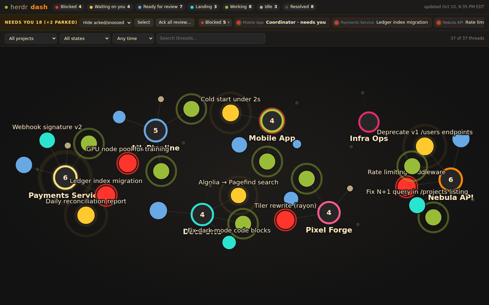
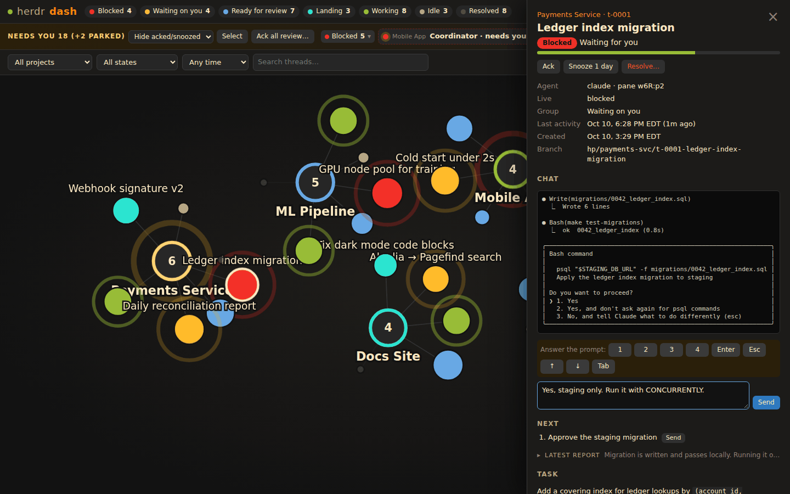
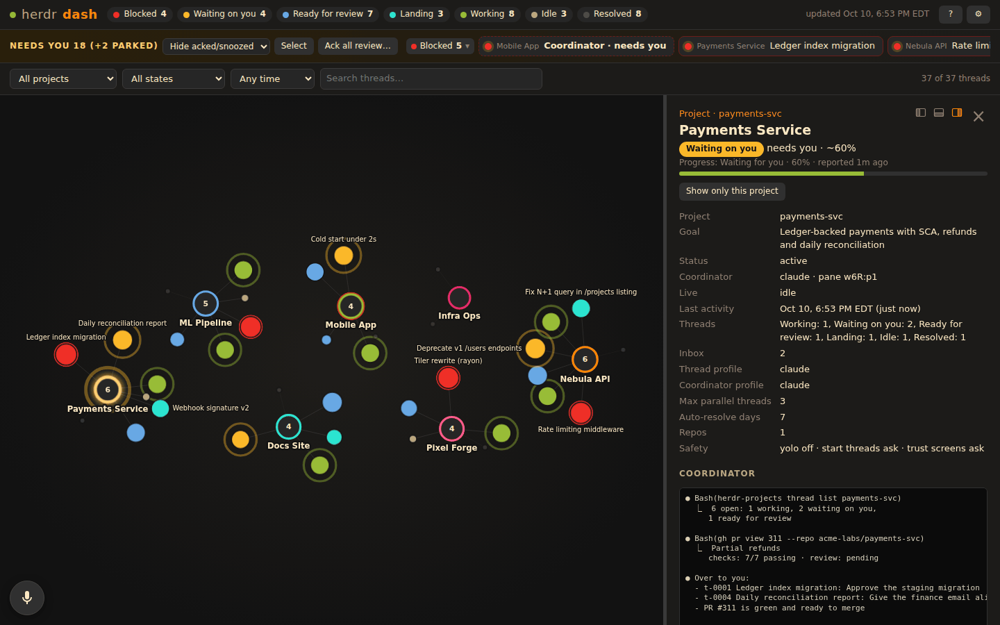
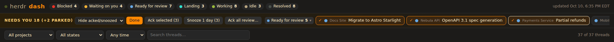
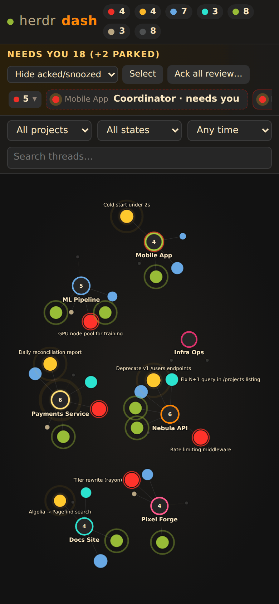
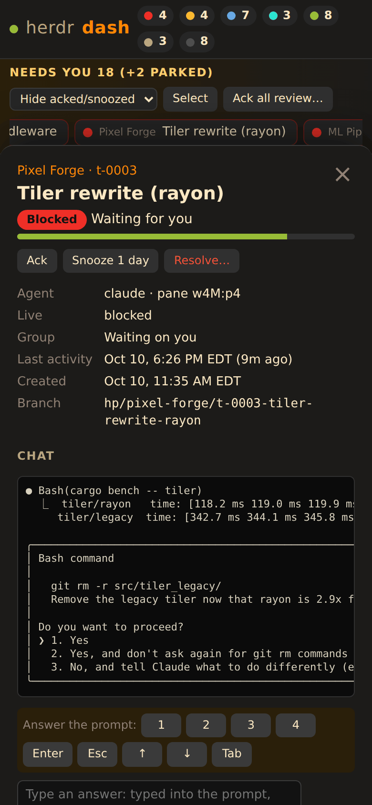

<p align="center">
  
</p>

<p align="center">
  <a href="LICENSE"></a>
  <a href="go.mod"></a>
  
  
  <a href="#try-it-in-30-seconds"></a>
</p>

<p align="center"><b>See every agent at a glance: who's working, who's stuck, who's waiting on you. Answer them from your browser.</b></p>

<p align="center">
  
</p>

herdr dash is a live, animated web dashboard for
[herdr](https://github.com/herdrdev/herdr) projects
([herdr-projects](https://github.com/eliasstravik/herdr-projects)). Projects
are hubs and their agent threads orbit them, colored by state, sized by how
recently they moved. One glance tells you what is
moving, what is done and what needs you. From the same page you can answer a
permission prompt, send a follow-up, ack a report or ping a coordinator,
always through `herdr-projects` and its safety checks.

> The screenshots and the demo use made-up projects and agents
> (`acme-labs/…`). Nothing in them is real.

## Features

### A live map of your herd



- **Projects are hubs, threads are nodes.** Green pulse = working, amber glow =
  waiting on you, red = blocked on a prompt, blue = ready for review, cyan =
  landing (PR approved), tan = idle, gray = resolved. Bigger = more recent.
- **Live over SSE.** One shared collector polls herdr; every open tab updates
  at once. No file watchers, no database.
- **Filters** by project, state, time window and free-text search. Times
  show in the viewer's time zone.

### Unblock agents without switching terminals



- **The agent's screen, live**, streamed into the panel (every 3s, faster
  right after you send something).
- **Quick replies** (`1` `2` `3` `Enter` `Esc` `↑` `↓` …) show up when the pane
  is blocked on a menu or permission prompt. Or type an answer.
- **Chat**: send a follow-up prompt. **Next**: forward one of the thread's
  own suggested next steps with one click.
- Task, latest report (sanitized markdown), PR and branch links, and
  copyable jump commands (`herdr agent focus …`) to reach the pane in your
  terminal.
- **Dock the panel** right, left or bottom and drag it to size; the graph
  refits around it, and the choice sticks per browser.

### Coordinator panel



Click a project hub for its coordinator: status, goal, settings and safety
summary, the coordinator's progress line and live screen, a message box,
the open threads, their latest reports (newest first), `TASKS.md`, the
`MEMORY.md` index and the inbox count.

### Triage what needs you



- **Needs-you strip** grouped by severity (blocked, waiting, review,
  landing), with counts and collapsible groups. Blocked or "needs you"
  coordinators show here too.
- **Select mode**: pick several threads, then *Ack selected* or *Snooze 1
  day*. *Ack all review…* clears a project's review pile by age.
- Acked and snoozed threads hide by default; a filter brings them back.

### Works on your phone

<p>
  
  &nbsp;
  
</p>

Same page, laid out for a narrow screen: the graph goes tall and the panel
slides up from the bottom. Answer a stuck agent from the couch.

## Try it in 30 seconds

Needs Go 1.26+, bash and perl. No herdr install needed:

```sh
git clone https://github.com/0xArchiviste/herdr-dash
cd herdr-dash
make demo          # http://127.0.0.1:8792
```

The demo runs the real binary against fictional data in [`demo/`](demo/)
(7 projects, 37 threads in every state). Stand-in `herdr`, `herdr-projects`
and `gh` scripts in `demo/bin/` come first on `PATH`, so buttons work and
nothing real is read or changed. `make demo DEMO_ADDR=127.0.0.1:9000` picks
another port.

## Quick start

Needs [herdr](https://github.com/herdrdev/herdr) with the
[herdr-projects](https://github.com/eliasstravik/herdr-projects) plugin, Go 1.26+, and
optionally `gh` (to find PRs herdr-projects has not recorded yet).

```sh
make build && ./bin/herdr-dash     # http://127.0.0.1:8791
```

### Run it as a systemd user service

```sh
make install       # copies to ~/.local/bin, installs deploy/herdr-dash.service, enables + restarts
loginctl enable-linger $USER       # optional: start without a login session
journalctl --user -u herdr-dash -f # logs
```

Extra flags go in `~/.config/herdr-dash/env`, e.g.
`HERDR_DASH_ARGS=--addr 0.0.0.0:8791`. The unit caps CPU at 25% and memory at 256M.

### Configuration

| Flag | Env (a flag wins) | Default |
| --- | --- | --- |
| `--addr` | `HERDR_DASH_ADDR` | `127.0.0.1:8791` |
| `--root` | `HERDR_DASH_ROOT`, then `HERDR_PROJECTS_ROOT` | `~/.herdr-projects` |
| `--herdr-projects` | `HERDR_DASH_HERDR_PROJECTS` | on `PATH`, else the herdr plugin build under `~/.config/herdr/plugins/` |
| `--read-only` | `HERDR_DASH_READ_ONLY` | off: refuses every write when on |
| `--auth` | `HERDR_DASH_AUTH` | `none` (the only mode so far) |
| `--write-burst`, `--write-per-min` | | `10`, `30` |
| `--herdr`, `--gh` | | `herdr`, `gh` |
| `--claude-dir`, `--codex-dir` | | `~/.claude/projects`, `~/.codex/sessions` |
| `--poll`, `--threads-every`, `--quiet-every`, `--gh-every` | | `5s`, 3× poll, `5m`, `10m` |

## How it works

```
 herdr, herdr-projects, gh ──(read-only commands)──┐
 PROJECT.md, TASKS.md, threads/*.md ───────────────┼──▶ collector ──SSE──▶ browser
 transcript mtimes ────────────────────────────────┘                          │
                                                                              │
 herdr-projects thread prompt|keys|ack|next|resolve ◀── allow-listed POST ────┘
 herdr-projects coordinator prompt
```

### Reads

| Source | Used for | Cadence |
| --- | --- | --- |
| `herdr-projects --root R list` | projects, counts | 15s |
| `herdr-projects --root R thread list SLUG --json` | threads, group, activity, PR | 15s (5m for all-resolved projects) |
| `PROJECT.md` front matter | project name, goal, settings | with the list |
| `herdr pane list` | live agent status, session id, coordinator "needs you" (`hp_sub`) | 5s |
| `~/.claude/projects/*/ID.jsonl`, `~/.codex/sessions/Y/M/D/*ID.jsonl` mtime | last activity | 5s (stat only, paths cached) |
| `herdr pane read PANE --source recent --lines 40` | the agent's screen | while a panel is open: 3s, 0.7s after a send |
| `.state/coordinators.json`, `.state/coordinator.json` | coordinator pane (never guessed: same session, or the recorded pane still in the project folder) | with the list |
| `herdr-projects --root R progress --pane PANE` | coordinator progress line | coordinator panel open: 10s |
| `herdr-projects --root R safety show SLUG` | safety summary | coordinator panel open, cached 1m |
| `TASKS.md`, `MEMORY.md`, `inbox/*.md`, `threads/t-NNNN.md`, `.task.md` | panels | panel open: 10s |
| `gh pr list --repo R --state all` | PRs herdr-projects has not recorded yet | 10m, only repos with such threads |

State colors follow herdr-projects' own grouping (`group_token`), split into
blocked vs waiting by the live pane status.

### Writes, and why they are safe

Every write goes through `herdr-projects`, never raw `herdr agent` commands,
so its refusals (blocked agent, text already in the input box, trust
screens) still apply.

| In the page | Runs |
| --- | --- |
| Chat: send a follow-up | `thread prompt SLUG ID --text-file -` (text on stdin) |
| Chat: quick replies / typed answer when the pane is blocked | `thread keys SLUG ID KEY... [--text=TEXT]` |
| Next list: Send | `thread next SLUG ID --line N` |
| Ack, Ack selected, Ack all review | `thread ack SLUG ID` |
| Resolve (after a confirm dialog) | `thread resolve SLUG ID` |
| Coordinator panel: message | `coordinator prompt SLUG --text-file -` |

- **Server side:** POST with a JSON body only, same-origin only; slug, id,
  keys and line validated (keys: `enter esc up down left right tab space
  backspace y n 0-9`, no ctrl chords); text length and control characters
  checked; prompt text goes on stdin, never into argv or a shell; one write
  at a time, a token bucket (`--write-burst` 10, `--write-per-min` 30), and
  every action logged. `--read-only` turns all of it off.
- **Never resent:** `agent_blocked` and `prompt_unconfirmed` are shown, not
  retried; an unconfirmed prompt gets a manual "Press Enter" button.
- The coordinator chat is send-only: herdr-projects has no key command for
  coordinators, so a blocked coordinator is answered in its pane.
- Snooze is per browser (localStorage) and changes nothing on disk.

## FAQ

**Is there authentication?**
Not yet. herdr dash binds to `127.0.0.1` by default. It shows task text,
reports and live pane screens, and it can prompt your agents, so only expose
it (`--addr 0.0.0.0:8791`) on a network you trust, such as a tailnet or a
LAN behind your router. Use `--read-only` if you want a view-only dashboard.

**Does it slow my agents down?**
No. One collector serves every tab. It stats transcripts instead of reading
them, reads pane screens only while a panel is open, and asks `gh` only
about branches without a recorded PR. The systemd unit runs it at `Nice=10`
with a 25% CPU cap.

**Which agents does it understand?**
Whatever herdr runs: Claude Code, Codex and opencode threads all show up.
Last-activity times are sharper for Claude Code and Codex, whose transcripts
it can stat.

**How do I retake the screenshots?**
`make screenshots` runs the demo and drives it with Playwright into
`docs/screenshots/`; ffmpeg, if installed, shrinks the PNGs and encodes
`hero.webp`. The demo data lives in `demo/gen.mjs` (`node demo/gen.mjs`
regenerates it).

## Development

```sh
make check
```

Runs `go vet`, `node --check`, and the Playwright E2E in `e2e/` against the
fixtures in `testdata/` and the demo, with stubbed `herdr-projects`, `herdr`
and `gh`. It asserts the API, sanitization, SSE, the page (graph, strip,
panels, filters, phone layout), the exact `herdr-projects` command each
action runs, that injection attempts, GET, non-JSON and cross-origin writes
are refused, the rate limit, that nothing outside the allow-list ran, and
that the demo names nothing real (no home paths, emails, IPs, real orgs or
real project names). Screenshots and the API snapshot land in
`e2e/artifacts/`; `node e2e/screenshot.mjs URL DIR` screenshots a running
instance.

## License

[MIT](LICENSE) © 2026 0xArchiviste
