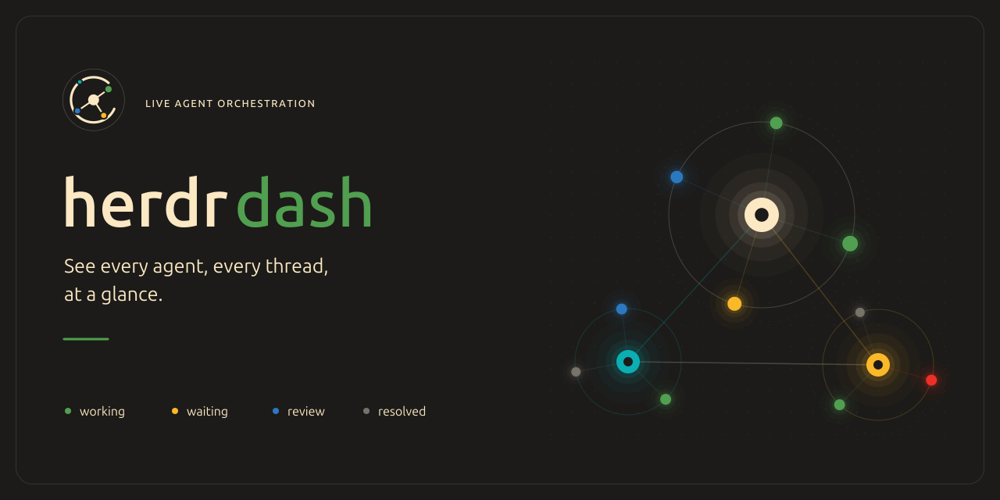
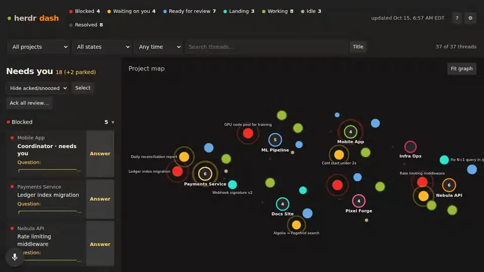
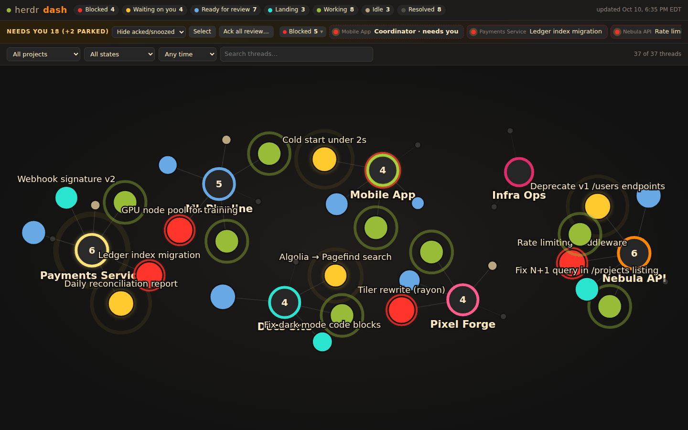
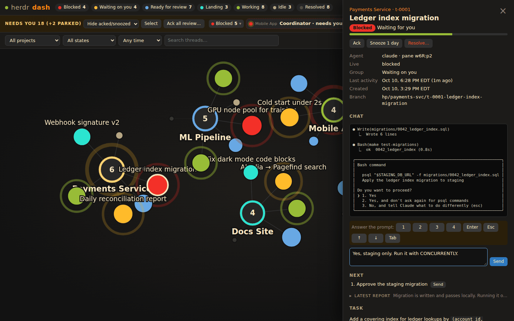
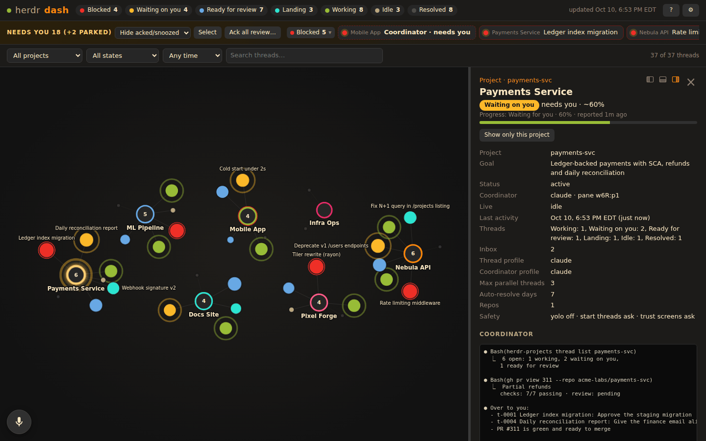
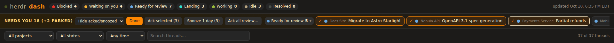
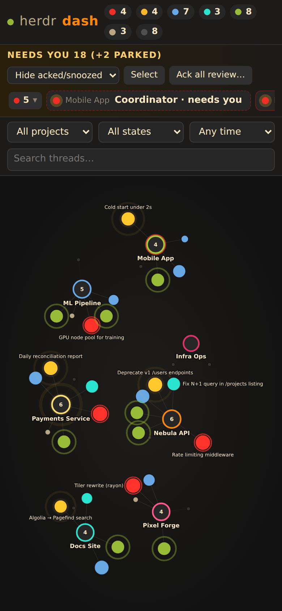
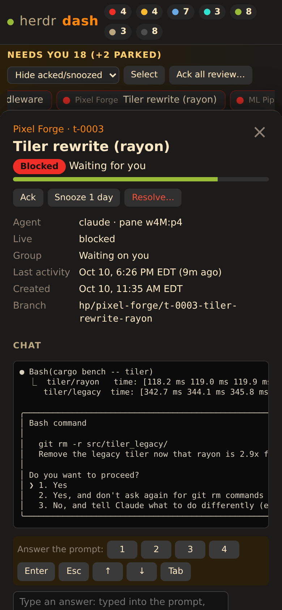

<p align="center">
  
</p>

<p align="center">
  <a href="LICENSE"></a>
  <a href="go.mod"></a>
  
  
  <a href="#try-it-in-30-seconds"></a>
</p>

<p align="center"><b>See every agent at a glance: who's working, who's stuck, who's waiting on you. Answer them from your browser.</b></p>

<p align="center">
  
</p>

herdr dash is a live, animated web dashboard for
[herdr](https://github.com/herdrdev/herdr) projects
([herdr-projects](https://github.com/eliasstravik/herdr-projects)). Projects
are hubs and their agent threads orbit them, colored by state, sized by how
recently they moved. One glance tells you what is
moving, what is done and what needs you. From the same page you can answer a
permission prompt, send a follow-up, ack a report or ping a coordinator,
always through `herdr-projects` and its safety checks.

> The screenshots and the demo use made-up projects and agents
> (`acme-labs/…`). Nothing in them is real.

## Features

### A live map of your herd



- **Projects are hubs, threads are nodes.** Green pulse = working, amber glow =
  waiting on you, red = blocked on a prompt, blue = ready for review, cyan =
  landing (PR approved), tan = idle, gray = resolved. Bigger = more recent.
- **Live over SSE.** One shared collector polls herdr; every open tab updates
  at once. No file watchers, no database.
- **Filters** by state, time window and free-text search. Times show in
  the viewer's time zone.
- **Project focus** on any number of projects at once: tick them in the
  picker (**P** opens it, type to filter; All, None, Only), or Ctrl/Cmd or
  Shift+click a project on the map. Chips show the focus, × removes one;
  nothing ticked shows everything. The graph, Needs-you strip, search
  results and the System strip's agents, queue and processes follow it
  live; unfocused projects hide, or fade with **Fade others**. The focus
  survives reloads and lives in the URL (`?focus=a,b`) for bookmarks.
- **Go to a project**: click a focus chip to pan and zoom the map to that
  project and pulse its nodes (click again to open its coordinator); hover
  lights it and dims the rest. Chips take Tab, ←/→, Enter and
  Delete/Backspace; on a phone tap goes and long-press removes. **Fit all**
  frames every focused project. The picker's **Go** (or **G**), a System
  strip agents row and hovering a Needs-you item do the same. Only the view
  moves; the layout is not reheated.
- **Content search** finds threads by what was said or done in them, not
  just their titles (see [Content search](#content-search)).

### Unblock agents without switching terminals



- **The agent's screen, live**, streamed into the panel (every 3s, faster
  right after you send something).
- **Prompt cards**: when the pane is blocked on a permission prompt ("run
  this command?", "edit this file?", "fetch this URL?"), a question menu
  (single or multi-select, with "Type something"), a trust dialog or a y/n
  confirmation, a card above the screen shows the question, the command,
  file and diff or URL, and one button per option, labelled with its text.
  Lasting grants ("don't ask again", "always allow") are marked but stay
  available. A click presses that option's keys once, only if the pane still
  shows that same prompt in the same pane; the server then watches the pane
  and the card says whether the prompt cleared, or that it still shows
  (nothing is resent). Claude Code, Codex (also on its alternate screen) and
  opencode screens are read, including commands and labels the agent wrapped
  over several lines; anything else falls back to the quick replies.
- **Dialog windows**: each agent waiting on a permission or a question gets
  its own floating window with the card, opened by itself for a new prompt
  (⚙ → "Open a window for each new prompt" turns that off). Several can be
  open at once; they have no backdrop, so the graph stays usable. Click to
  bring one to front, drag it by its title bar (mouse or touch), `–`
  minimises it to the tray at the bottom, `×` or `Esc` closes it, `Alt+W`
  cycles through them, and digits `1`–`9` pick an option of the focused one.
  Positions are kept per window. A thread's or coordinator's screen and chat
  open in the same kind of window (Shift+click its node, `⧉` on its strip
  chip or in the panel), so several can be watched side by side; they come
  back after a reload, and the three front-most stream their screens.
- **Tray and docks**: the tray takes any number of windows (it wraps; `+N`
  lists the rest); drag its buttons to reorder them and its `⠿` grip to move
  it to another edge or corner. Windows dock right, left or bottom: drag one
  onto an edge, press its `⇥` button or `Alt+Shift+D` (right → left → bottom
  → floating). A dock holds any number, as tabs or a resizable split; drag a
  tab or pane to reorder it, out to float it, or into another dock;
  `Alt+]` / `Alt+[` step through tabs. Order, docks and the tray's place are
  kept across reloads. On a phone windows are full-width sheets, one at a
  time; docked ones are tabs of one sheet.
- **Quick replies** (`1` `2` `3` `Enter` `Esc` `↑` `↓` …) show up when the pane
  is blocked. Or type an answer.
- **Chat**: send a follow-up prompt. **Next**: forward one of the thread's
  own suggested next steps with one click.
- Task, latest report (sanitized markdown), PR and branch links, and
  copyable jump commands (`herdr agent focus …`) to reach the pane in your
  terminal.
- **Dock the panel** right, left or bottom and drag it to size; the graph
  refits around it, and the choice sticks per browser.

### Coordinator panel



Click a project hub for its coordinator: status, goal, settings and safety
summary, the coordinator's progress line and live screen, a message box,
the open threads, their latest reports (newest first), `TASKS.md`, the
`MEMORY.md` index and the inbox count.

Use **Clear filters** to return to all threads after searching or filtering.
Use **Fit graph** to bring the visible projects back into view after panning or zooming.

### Triage what needs you



- **Needs-you queue** grouped by severity (blocked, waiting, review,
  landing), with counts and collapsible groups. The queue scrolls vertically beside
  the map on desktop and above it on smaller screens. Blocked or "needs you"
  coordinators show here too. A blocked item shows a short prompt summary
  ("Permission: Bash make test", "Question: Which DB?") and an *Answer*
  button that opens its dialog window, without the panel; every item has a
  `⧉` button that opens it in a window.
- **Notifications** (opt-in, ⚙ → "Notify me of new prompts"): a browser
  notification when a new prompt appears, with its summary.
- **Select mode**: pick several threads, then *Ack selected* or *Snooze 1
  day*. *Ack all review…* clears a project's review pile by age.
- Acked and snoozed threads hide by default; a filter brings them back.

### Works on your phone

<p>
  
  &nbsp;
  
</p>

Same page, laid out for a narrow screen: status names stay visible, the queue
scrolls above the graph, and the detail panel slides up from the bottom. Answer a stuck agent from the couch.

## Try it in 30 seconds

Needs Go 1.26+, bash and perl. No herdr install needed:

```sh
git clone https://github.com/0xArchiviste/herdr-dash
cd herdr-dash
make demo          # http://127.0.0.1:8792
```

The demo runs the real binary against fictional data in [`demo/`](demo/)
(7 projects, 37 threads in every state). Stand-in `herdr`, `herdr-projects`
and `gh` scripts in `demo/bin/` come first on `PATH`, so buttons work and
nothing real is read or changed. `make demo DEMO_ADDR=127.0.0.1:9000` picks
another port.

## Quick start

Needs [herdr](https://github.com/herdrdev/herdr) with the
[herdr-projects](https://github.com/eliasstravik/herdr-projects) plugin, Go 1.26+, and
optionally `gh` (to find PRs herdr-projects has not recorded yet).

```sh
make build && ./bin/herdr-dash     # http://127.0.0.1:8791
```

### Run it as a systemd user service

```sh
make install       # copies to ~/.local/bin, installs deploy/herdr-dash.service, enables + restarts
loginctl enable-linger $USER       # optional: start without a login session
journalctl --user -u herdr-dash -f # logs
```

Extra flags go in `~/.config/herdr-dash/env`, e.g.
`HERDR_DASH_ARGS=--addr 0.0.0.0:8791`, and so do the voice settings
(`CLOUDFLARE_API_TOKEN=...`; keep the file mode 600, see [Voice](#voice)).
The unit caps CPU at 25% and memory at 256M.

### Desktop app

`make desktop-linux` (or `desktop-windows`, `desktop-darwin`) builds a native
window around the same dashboard. It connects to the running service, or
embeds a server when none answers. It loads the local voice model at startup
so the first command does not wait. On Windows it reaches the Dash in WSL at
`http://127.0.0.1:8791`. See [desktop app](docs/desktop.md).

### Configuration

| Flag | Env (a flag wins) | Default |
| --- | --- | --- |
| `--addr` | `HERDR_DASH_ADDR` | `127.0.0.1:8791` |
| `--root` | `HERDR_DASH_ROOT`, then `HERDR_PROJECTS_ROOT` | `~/.herdr-projects` |
| `--herdr-projects` | `HERDR_DASH_HERDR_PROJECTS` | on `PATH`, else the herdr plugin build under `~/.config/herdr/plugins/` |
| `--read-only` | `HERDR_DASH_READ_ONLY` | off: refuses every write when on |
| `--auth` | `HERDR_DASH_AUTH` | `none` (the only mode so far) |
| `--public-url` | `HERDR_DASH_PUBLIC_URL` | none; an `https://host[:port]` in front of this server, see Voice |
| `--write-burst`, `--write-per-min` | | `10`, `30` |
| `--herdr`, `--gh` | | `herdr`, `gh` |
| `--claude-dir`, `--codex-dir` | | `~/.claude/projects`, `~/.codex/sessions` |
| `--poll`, `--threads-every`, `--quiet-every`, `--gh-every` | | `5s`, 3× poll, `5m`, `10m` |
| `--threads-max-age` | | `1m`; a project whose files and panes did not change is re-listed this often |
| `--pprof-addr` | `HERDR_DASH_PPROF_ADDR` | off; a loopback address such as `127.0.0.1:6060` serves Go's profiler |
| `--proc` | `HERDR_DASH_PROC` | `/proc`; `off` hides machine and process numbers (see [System](#system)) |
| `--routing-config` | `HERDR_DASH_ROUTING_CONFIG` | `$XDG_CONFIG_HOME/herdr-projects/routing.toml`, else `~/.config/herdr-projects/routing.toml` (see [Agent routing](#agent-routing-preview)) |
| `--usage` | `HERDR_DASH_USAGE` | `auto`; `off`, or a list like `claude,codex` (see [Usage](#usage)) |
| `--memex` | `HERDR_DASH_MEMEX` | `off`; `memex` (on `PATH`) or a path turns on transcript search |
| `--memex-timeout`, `--memex-per-min` | | `2s`, `30` |

## How it works

```
 herdr, herdr-projects, gh ──(read-only commands)──┐
 PROJECT.md, TASKS.md, threads/*.md ───────────────┼──▶ collector ──SSE──▶ browser
 transcript mtimes ────────────────────────────────┘                          │
                                                                              │
 herdr-projects thread prompt|keys|ack|next|resolve ◀── allow-listed POST ────┘
 herdr-projects coordinator prompt
 herdr pane send-keys|send-text (blocked coordinator, verified pane only)
```

### Reads

| Source | Used for | Cadence |
| --- | --- | --- |
| `herdr-projects --root R list` | projects, counts | 15s, only when a project's files or the panes changed (at least every 1m) |
| `herdr-projects --root R thread list SLUG --json` | threads, group, activity, PR | 15s, only when the project's `threads/`, `.state/`, list line or thread panes changed (at least every 1m; 5m for all-resolved projects) |
| `PROJECT.md` front matter | project name, goal, settings | with the list |
| `herdr pane list` | live agent status, session id, coordinator "needs you" (`hp_sub`) | 5s |
| `~/.claude/projects/*/ID.jsonl`, `~/.codex/sessions/Y/M/D/*ID.jsonl` mtime | last activity | 5s (stat only, paths cached) |
| `herdr pane read PANE --source recent --lines 60 --format ansi` (`--source detection` when that is blank: an alternate-screen agent such as Codex) | the agent's screen, and the prompt card of a blocked pane | while a panel or window is open: 3s, 0.7s after a send; blocked panes only: 5s; after an answer, every 0.25s for up to 3s to confirm the prompt left |
| `.state/coordinators.json`, `.state/coordinator.json` | coordinator pane (never guessed: same session, or the recorded pane still in the project folder) | with the list |
| `herdr-projects --root R progress --pane PANE` | coordinator progress line | coordinator panel open: 10s |
| `herdr-projects --root R safety show SLUG` | safety summary | coordinator panel open, cached 1m |
| `TASKS.md`, `MEMORY.md`, `inbox/*.md`, `threads/t-NNNN.md`, `.task.md` | panels | panel open: 10s |
| `gh pr list --repo R --state all` | PRs herdr-projects has not recorded yet | 10m, only repos with such threads |
| `threads/t-NNNN{.task,,.next}.md`, `PROJECT.md`, `TASKS.md`, `MEMORY.md` | content search | on search only (stat, re-read when the mtime changed) |
| `memex search --non-interactive --mode lexical …` (opt-in) | content search in transcripts | on search only |

A hidden page closes its stream and panel feeds and reconnects when shown
again; the stream is gzipped for browsers that accept it.

The state carries a build id (a hash of the embedded frontend). After
`make install`, open pages see it change when the stream reconnects, show
"Updated — reload", and reload by themselves once nothing is being typed.

State colors follow herdr-projects' own grouping (`group_token`), split into
blocked vs waiting by the live pane status.

### Writes, and why they are safe

Every write goes through `herdr-projects`, never raw `herdr agent` commands,
so its refusals (blocked agent, text already in the input box, trust
screens) still apply.

| In the page | Runs |
| --- | --- |
| Chat: send a follow-up | `thread prompt SLUG ID --text-file -` (text on stdin) |
| Chat: quick replies / typed answer when the pane is blocked | `thread keys SLUG ID KEY... [--text=TEXT]` |
| Prompt card: an option | `thread keys SLUG ID KEY...`, then for an option that takes text `thread keys SLUG ID enter --text=TEXT` |
| Next list: Send | `thread next SLUG ID --line N` |
| Ack, Ack selected, Ack all review | `thread ack SLUG ID` |
| Resolve (after a confirm dialog) | `thread resolve SLUG ID` |
| Coordinator panel: message | `coordinator prompt SLUG --text-file -` |
| Coordinator panel: prompt card, keys (blocked only) | `herdr pane get PANE`, then `herdr pane send-keys PANE KEY...` (and `send-text` for typed answers) |

- **Server side:** POST with a JSON body only, same-origin only; slug, id,
  keys and line validated (keys: `enter esc up down left right tab space
  backspace y n 0-9`, no ctrl chords); text length and control characters
  checked; prompt text goes on stdin, never into argv or a shell; one write
  at a time, a token bucket (`--write-burst` 10, `--write-per-min` 30), and
  every action logged. `--read-only` turns all of it off.
- **Never resent:** `agent_blocked` and `prompt_unconfirmed` are shown, not
  retried; an unconfirmed prompt gets a manual "Press Enter" button.
- **Prompt answers:** the page sends only the prompt's signature and the
  option's number. The server re-reads the pane, parses it again, refuses
  if it shows another prompt (or none) now, and presses the keys from its
  own parse.
- **Coordinators:** herdr-projects has no key command for them, so a blocked
  coordinator is answered with `herdr pane send-keys`, only on the pane the
  panel identifies (never guessed), only after `herdr pane get` shows the
  same agent session still blocked, with the same key allow-list, and
  logged. Trust screens stay the user's to answer in the pane.
- Snooze is per browser (localStorage) and changes nothing on disk.

## Voice

Dictation into every chat box and voice navigation, both optional
(`static/voice.js`). Press `?` for the keys and commands; the ⚙ button sets
the keys (stored per browser).

- Dictation: a mic next to each chat box, or `Alt+M` (toggle, or hold to
  talk), writes into the box with the live interim transcript shown under it.
  It never sends.
- Voice navigation: `Alt+V` or the floating mic (bottom left, also on phones).
  "open nebula api", "show thread 3 in payments service", "show blocked / waiting /
  review", "next / previous", "search widget", "close panel", "focus chat",
  "dock bottom / left / right", "help", "stop listening". "ack this",
  "resolve this" and "send" ask yes/no first (by voice or click).
- With a blocked thread or coordinator open: "yes / allow", "no / deny",
  "option two" answer its prompt card; "always allow" / "don't ask again"
  asks yes/no first.
- Commands are resolved in the page by a small grammar with fuzzy matching
  against project and thread names. Only phrases it cannot place go to the
  server, which asks a Cloudflare Workers AI decision model
  (`@cf/cloudflare/clef-flash`) to pick one of the page's candidate actions or
  "none" (1.5s timeout, cached, rate limited).
- Speech: the browser's Web Speech API where it exists (Chrome and Edge send
  the audio to Google or Microsoft; Safari may recognize on the device).
  Without it (Firefox), or when chosen in settings, the clip is recorded,
  posted to the server and transcribed by Workers AI Whisper
  (`@cf/openai/whisper-large-v3-turbo`).
- The microphone needs HTTPS (or localhost). On a tailnet, e.g.
  `tailscale serve --bg --https=8793 http://127.0.0.1:8791`.
  Set `--public-url https://<machine>.<tailnet>.ts.net:8793` and plain-http
  page loads from other machines are redirected there (302, path and query
  kept); requests from the proxy itself (loopback, or `X-Forwarded-Proto:
  https`) and all API, stream and asset requests are not, so open tabs keep
  working, and their voice buttons link to the secure version.

Server side (env only, it holds a secret; both features are off without it):
`CLOUDFLARE_API_TOKEN` (Workers AI permission), `CLOUDFLARE_ACCOUNT_ID`,
`HERDR_DASH_INTENT_MODEL` and `HERDR_DASH_STT_MODEL` (a model id, or `off`).
The token is only sent to Cloudflare, never to the page.

### Local engine

Set `HERDR_DASH_STT=local` and choose **Local model on this machine** in
voice settings. The only local model is
[NVIDIA Parakeet TDT 0.6B v3](https://huggingface.co/nvidia/parakeet-tdt-0.6b-v3),
using the k2-fsa int8 ONNX conversion through sherpa-onnx 1.13.8 on CPU.
There is no automatic fallback to browser or cloud transcription.

TDT v3 processes buffered utterances rather than cache-aware streaming.
The adapter re-decodes the current utterance every two seconds for a
replaceable preview. A 1.2-second pause, the stop button, or the 20-second
utterance limit commits one final segment. Dictation replaces the selection
at the cursor and never sends the chat. Audio is 16 kHz mono float32 over
`/api/voice/stream`, relayed to a loopback-only Python sidecar. The microphone
starts after the model is ready, so cold loading cannot drop the first words.

Setup:

- `make stt-install` installs a pinned Python runtime in
  `~/.local/share/herdr-dash/stt-runtime` (uses uv and Python 3.12, or an
  existing compatible Python with venv/pip).
- `make stt-fetch` downloads and verifies the model before enabling voice.
  First use can also download it; allow up to five minutes on a slow link.
- Add `HERDR_DASH_STT=local` to the service environment and restart Dash.

Weights are CC-BY-4.0: original model by NVIDIA, quantized ONNX conversion by
[k2-fsa/sherpa-onnx](https://github.com/k2-fsa/sherpa-onnx).
The converted archive is 487,170,055 bytes (about 465 MiB), verified against
SHA-256 `5793d0fd397c5778d2cf2126994d58e9d56b1be7c04d13c7a15bb1b4eafb16bf`.
The archive and weights remain outside the repository. Downloads are staged
and published only after verification; older local-engine files are ignored.
See [local voice validation](docs/local-voice.md) for provenance and measurements.

| Setting | Meaning |
| --- | --- |
| `HERDR_DASH_STT` | `local` enables the engine (default off) |
| `HERDR_DASH_STT_IDLE` | Stop after the last session closes (default `2m`) |
| `HERDR_DASH_STT_THREADS` | CPU inference threads (default 2, range 1–8) |
| `HERDR_DASH_STT_DIR` | Model cache parent directory |
| `HERDR_DASH_STT_PYTHON` | Override the installed runtime's Python executable |

With user systemd available, the sidecar uses `MemoryMax=2G` and
`CPUQuota=200%`; otherwise it runs directly. Voice navigation has an optional
browser speech-detection toggle: it keeps the microphone open while enabled,
but suppresses quiet audio frames before sending them. This is an energy
threshold, so background noise and quiet speech can affect detection. No
external browser scripts or models are downloaded for this toggle.

## Usage

A strip in the header shows what is left on your agent plans: Claude Code's
5-hour and weekly limits, Codex's rate-limit windows and credits, and the
opencode provider's balance. Green, amber and red as it runs low; click for
reset times (in your local time) and when the numbers were last true
(`static/usage.js`, `usage.go`). Each source is detected on its own and
left out when its files are absent:

- **Claude**: Claude Code's own cached `/usage` answer in `~/.claude.json`
  while it is fresh, else the endpoint Claude Code calls, with the OAuth
  token from `~/.claude/.credentials.json`. The token is only read: never
  refreshed or written, and not used once expired. When the call fails the
  last cached answer is shown as historical data. The header says `stale`
  without capacity gauges when the observation is older than the network
  interval or any observed reset has passed. Details preserve the last
  observed usage and explain failures (including expired credentials).
  Passed resets never imply an unused new window. The browser also ages
  observations if polling fails. No usable answer means `n/a`.
  These are account plan observations from Claude Code's local cache or
  `https://api.anthropic.com/api/oauth/usage`, not a per-thread token budget
  or a guarantee that the next request will be accepted. The endpoint is
  the one used by Claude Code and its schema may change. If credentials
  expire, run Claude Code to renew them; Dash does not renew them itself.
- **Codex**: the last `rate_limits` event in the newest session file under
  `~/.codex/sessions`. No network.
- **opencode**: the configured model's provider. OpenRouter's `/credits`
  when that is the provider; "unavailable" for providers without a balance
  API.

Nothing is read until a page asks; local files are re-read at most every
`--usage-every` (`2m`), providers called at most every `--usage-net-every`
(`5m`, 3 s timeout), one read per source at a time. Credentials go only to
the provider's own endpoint, never to the page or the log. Paths:
`--claude-home`, `--claude-state`, `--codex-dir`, `--opencode-config`,
`--opencode-data` (each with a `HERDR_DASH_*` env), defaulting to
`$CLAUDE_CONFIG_DIR` / `~/.claude`, `~/.codex/sessions` and opencode's XDG
directories.

## System

Next to the usage strip, a second strip shows the machine and the herd
(`static/system.js`, `sysstat.go`): CPU, RAM and swap, active agents
(working, waiting on you, idle) and the launch queue. It turns amber at 80%
and red at 95% (of a core, of RAM, or of a project's
`max_parallel_threads`). Click it for per-core sparklines, load average,
each project's open threads against its limit, the CPU and RSS of every
pane's processes heaviest first, and the queue in order with project,
profile and wait time. Clicking a process or queue row opens its thread.

- **Machine**: `/proc/stat`, `/proc/meminfo`, `/proc/loadavg`. On WSL these
  are the WSL VM's numbers, and the page says so.
- **Processes**: a process belongs to a pane when its environment carries
  herdr's `HERDR_PANE_ID`. The pane maps to its thread or coordinator.
  Dash marks its own children (`HERDR_DASH_ROLE`), so the Dash service and
  the voice sidecar get rows of their own. Each environment is read once.
  After that, every sample reads one `stat` file per pane process.
- **Queue**: threads `herdr-projects thread list` already reports as
  starting, waiting for the ticker to start the agent (`prompt_pending`),
  retrying (`launch_attempts`), stuck or failed. No extra calls.
  herdr-projects starts accepted threads at once; `max_parallel_threads`
  only warns, so the queue shows launches, not slot waits.

Samples ride the collector's pane tick (`--poll`) and run only while some
page holds the event stream open. Pages close it while hidden. A frame goes
out only when it changed. Without `/proc` (macOS, Windows) or with `--proc off`,
the strip says the numbers are unavailable; agents and the queue still show.

## Agent routing (preview)

The **Routing** button (filter bar) opens a window that edits which agent a
new thread would get, per mode: **Planning**, **Coding** and **Crawl +
summary**. Each mode has an ordered list of candidates (a provider, a
herdr-projects profile, optionally a model). Nothing is built in: the lists
are yours, and `docs/routing.example.toml` is only an example.

This is stage 1: **preview only**. herdr-projects does not ask Dash before
a launch yet, so saving changes no launch and never touches a running
agent. Saving writes `routing.toml` and nothing else.

- **Scopes**: global, a project, a thread. For each mode the first scope
  with its own list (thread, then project, then global) supplies the whole
  list; lists never merge. A scope without a list shows the inherited one,
  read-only, with *Override here*; *Reset to inherited* drops an override.
  `enabled` inherits on its own, project then global, default off. No file,
  or routing off, means legacy launches: PROJECT.md `thread_profile`.
- **Reorder** by dragging a card or with its ↑ ↓ buttons (keyboard
  friendly). Edits stay a draft until *Save*.
- **Why this choice?** asks the server which candidate a new (or a given)
  thread in a project would get, from the saved policy and current usage,
  with a reason for every candidate it skipped. The same engine answers
  `herdr-dash routing preview --project SLUG --mode coding [--thread t-0001] [--json]`
  without a server (the server flags apply).
- **Usage decides, carefully.** Claude and Codex candidates need a fresh
  reading (newer than `usage.max_age_seconds`, default 900, not past its
  reset or expiry) with every window under `usage.avoid_at_percent`
  (default 90). Unknown or stale usage skips to the next candidate; if none
  qualifies the thread would queue. opencode qualifies only as its
  self-hosted default model: a metered provider (OpenRouter) or another
  model is refused. Metered per-token providers (RefuseLess and the like)
  are not valid providers at all.
- **Not enforced**: Claude and Codex internal subagents; only helpers herdr
  launches will be routed. Caps are reserved (`caps` tables are kept and
  reported, not enforced).

The file is hand-editable. Saves are atomic (lock file, revision check,
temp file, fsync, rename, mode 0600); a save from a stale tab or after a
hand edit is refused as a conflict, and an invalid file or an unknown
`version` is never rewritten. A symlinked `routing.toml` is read but not
replaced, and a directory others can write is refused. Comments are not
kept when Dash saves. Writes share the guard of every other action
(read-only mode, same-origin JSON, the write rate limit).

## Content search

The search box has two modes; the button next to it or **Alt+C** switches
(remembered per browser), **/** focuses it.

- **Title**: filters the graph by thread titles as you type, in the page.
- **Content**: finds threads by what was said or done in them: their task,
  report and Next files, and a project's `PROJECT.md`, `TASKS.md` and
  `MEMORY.md`; with `memex` turned on, agent transcripts and memories too.
  Results list the thread or project, the source, the time and a
  highlighted snippet; matching nodes light up in the graph and a click
  opens the panel.

Content search runs only on Enter or after a 400 ms pause with 3+ characters.
The file index lives in memory and is refreshed by mtime on search, never in
the background, so an idle dashboard costs nothing more. memex runs lexical
searches only, one process at a time (a newer search cancels the older one),
with a 2 s limit, a per-query cache and a rate limit. Transcript hits are
mapped to threads by the live pane's session, then by working directory (a
thread's worktree or folder, a project folder); hits from a project's repo
show under the project, others are dropped. Add-ons (voice) can call
`hd.search(text, { mode: "content" | "title" })`.

Transcript search is **opt-in** (`--memex memex`) because `memex search`
first ingests the transcripts written since its last run. Warm, a search
costs ~0.1 s and ~50 MB; after a backlog it was measured at 6.7 s, 8 s of CPU
and 670 MB, which the service's `CPUQuota=25%` / `MemoryMax=256M` turn into
timeouts or an OOM kill. With `auto_index_on_search = false` in
`~/.memex/config.toml` (and memex's own indexing keeping the index fresh),
searches stay read-only and fast.

## FAQ

**Is there authentication?**
Not yet. herdr dash binds to `127.0.0.1` by default. It shows task text,
reports and live pane screens, and it can prompt your agents, so only expose
it (`--addr 0.0.0.0:8791`) on a network you trust, such as a tailnet or a
LAN behind your router. Use `--read-only` if you want a view-only dashboard.

**Does it slow my agents down?**
No. One collector serves every tab. It stats transcripts instead of reading
them, reads pane screens only while a panel is open, and asks `gh` only
about branches without a recorded PR. The systemd unit runs it at `Nice=10`
with a 25% CPU cap.

**Which agents does it understand?**
Whatever herdr runs: Claude Code, Codex and opencode threads all show up.
Last-activity times are sharper for Claude Code and Codex, whose transcripts
it can stat.

**How do I retake the screenshots?**
`make screenshots` runs the demo and drives it with Playwright into
`docs/screenshots/`; ffmpeg, if installed, shrinks the PNGs and encodes
`hero.webp`. The demo data lives in `demo/gen.mjs` (`node demo/gen.mjs`
regenerates it).

## Development

```sh
make check
```

Runs `go vet`, `node --check`, `go test`, and the Playwright E2E in `e2e/` against the
fixtures in `testdata/` and the demo, with stubbed `herdr-projects`, `herdr`
and `gh`. It asserts the API, sanitization, SSE, the page (graph, strip,
panels, filters, phone layout), the exact `herdr-projects` command each
action runs, that injection attempts, GET, non-JSON and cross-origin writes
are refused, the rate limit, that nothing outside the allow-list ran, and
that the demo names nothing real (no home paths, emails, IPs, real orgs or
real project names). `go test` runs the prompt parser on screens taken
from real Claude Code, Codex and opencode panes (`testdata/prompts/`);
`e2e/prompts.test.mjs` drives the cards, the exact keys, the prompt-cleared
check and the coordinator path; `e2e/windows.test.mjs` drives the dialog and
thread windows (several at once, drag, tray, Esc, Alt+W, reload, phone
sheets) and the answer confirmation on 76-column Claude Code and Codex
screens. `e2e/voice.test.mjs` drives voice with a mocked
`SpeechRecognition`, Chromium's fake microphone and a fake Workers AI:
dictation, the commands, the confirmations, the intent fallback and that the
token never reaches the page. `e2e/usage.test.mjs` runs the usage strip
against fixture credentials and sessions and a stub provider server: the
request shape, caching, timeouts, disabled and unavailable states, and that
no credential reaches the page, the API or the log. Screenshots and the API snapshot land in
`e2e/artifacts/`; `node e2e/screenshot.mjs URL DIR` screenshots a running
instance.

## License

[MIT](LICENSE) © 2026 0xArchiviste

## Install as a herdr plugin

```sh
herdr plugin install 0xArchiviste/herdr-dash
```

The install builds the binary with `go build` (Go 1.26 on PATH). Then run the
actions *herdr dash: start*, *open*, *status* or *stop* (e.g.
`herdr plugin action invoke open --plugin 0xarchiviste.herdr-dash`). Put flags such as
`HERDR_DASH_ADDR=0.0.0.0:8791` or `HERDR_DASH_ARGS=--read-only` in
`$(herdr plugin config-dir 0xarchiviste.herdr-dash)/env`, and touch `autostart`
in that directory to start the dashboard with herdr. If you already run it as
the systemd service (`make install`), the actions detect it and leave it alone.
